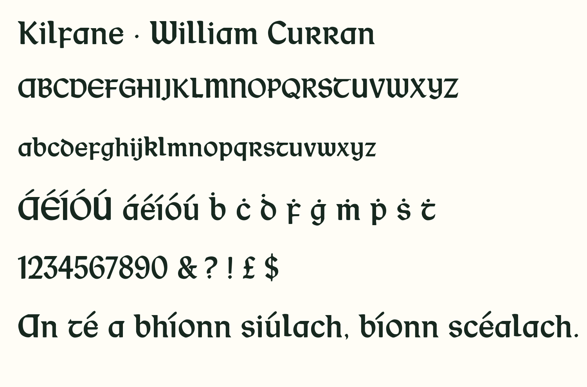

# Kilfane Study 1

Original-source Regular candidate, version 2.001; the released family remains
version 2.000. See [the handoff](../HANDOFF.md) for decisions and unresolved work.
The fonts use the existing [OFL](OFL.txt). This directory contains no archival scans.

| Contents | Purpose |
|---|---|
| `fonts/` | Separately installable OTF/TTF, web WOFF/WOFF2 and construction provenance |
| `traces/kilfane.json` | Candidate trace geometry, 78 newly sourced entries and five retained entries |
| `traces/evidence.json` | Source hashes, calibration, glyph boxes and decisions |
| `traces/source-regions.json` | Source segmentation regions and labels |
| `metrics.json` | Per-glyph before/after image-fit results and caveats |
| `artifact-manifest.json` | SHA-256 fingerprints of the candidate artifacts |
| `text-proof.png` | Text rendered from the candidate; no archival image pixels |



## Reproduce

From the repository root, create a Python 3.12 virtual environment and install
`requirements-study.txt`. This records the dependency versions used for the study;
the main release has its own Python 3.13 toolchain in `requirements.txt`.
The study builder uses the executable bundled by `ttfautohint-py`.

Retrieve the **JPEG** entries `N516` and `N47` in `research/downloads.json` into
`build/research/original-specimens/`, keeping their manifest filenames. Verify
their SHA-256 hashes before using the saved region coordinates. JP2 is also listed
for preservation, but the recorded coordinates and image hashes refer to JPEG.
Consult the institutions' terms for use; the files are not automatically downloaded
by tests or builds. A changed server image should be reviewed and recorded, not
silently accepted under the old hash.

```sh
python scripts/kilfane_study.py --sources build/research/original-specimens --regions research/kilfane-study-01/traces/source-regions.json --output build/kilfane-study/traces
python scripts/build_kilfane_study.py --traces build/kilfane-study/traces --output build/kilfane-study/fonts
python scripts/audit_kilfane_study.py --sources build/research/original-specimens --regions research/kilfane-study-01/traces/source-regions.json --baseline fonts/otf/Kilfane-Regular.otf --candidate build/kilfane-study/fonts/KilfaneStudy1-Regular.otf --output build/kilfane-study/audit
python -m pytest -q tests
```

By default the tests inspect the committed candidate. To test the fresh build,
set `STUDY_FONT_DIR=build/kilfane-study/fonts` in the environment before running
pytest (PowerShell: `$env:STUDY_FONT_DIR='build/kilfane-study/fonts'`).
The source audit generates 30 local proof PNGs and metrics; those PNGs contain
archive pixels and must stay out of Git unless redistribution terms are established.

The retained five trace entries come from the existing `sources/traced/kilfane.json`.
The build imports the existing project's curve fitter, glyph construction, spacing,
kerning and feature code. It is not a standalone build outside this repository.
Output may depend on platform and tool versions; byte-identical reconstruction
across platforms has not been established for the study candidate.
