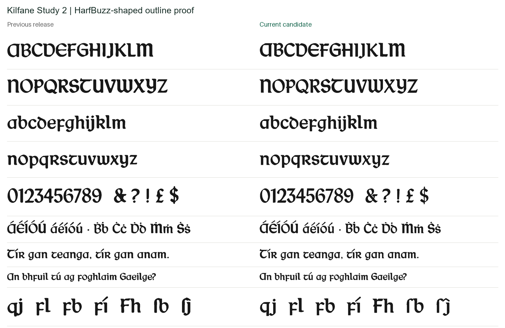
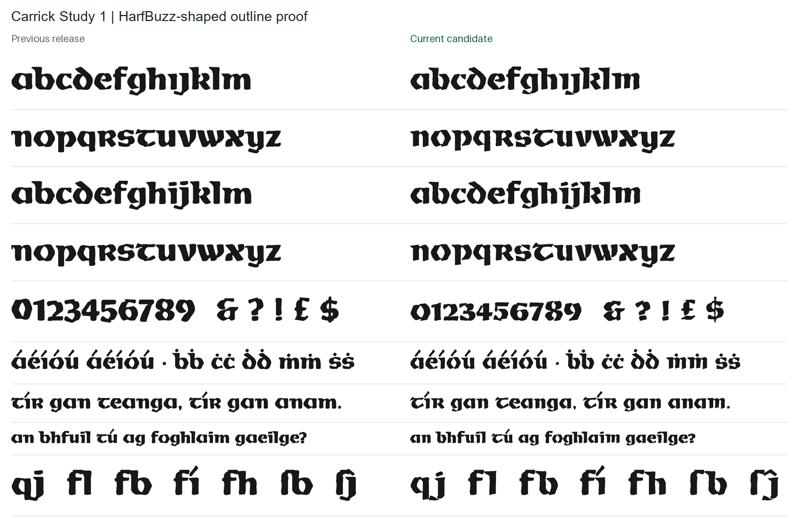
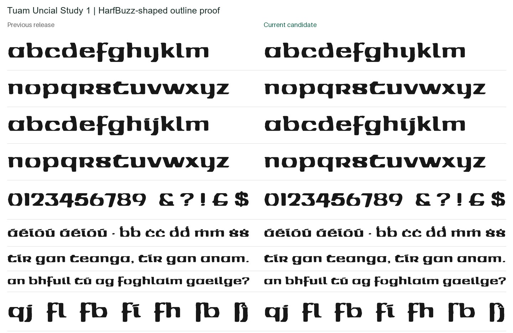
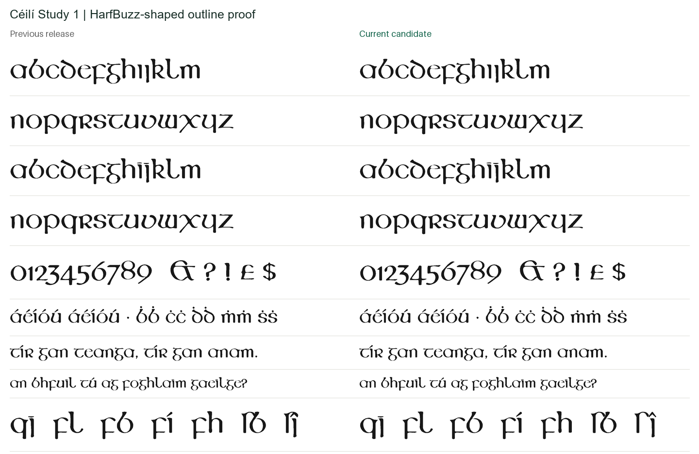

# Original-source round 2

Four separately named Regular candidates, with source improvements for Kilfane
and Carrick and a full-height spacing correction for all four faces. These are
research builds, in the public domain ([CC0 1.0](LICENSE.txt)); the released families are unchanged.

| Candidate | Outline work in this round | Glyphs / code points |
|---|---|---:|
| [Kilfane Study 2](kilfane/fonts/) | 14 named source marks; Study 1 bodies retained | 458 / 402 |
| [Carrick Study 1](carrick/fonts/) | 40 of 45 source entries reconstructed from N513 | 262 / 400 |
| [Tuam Uncial Study 1](tuam/fonts/) | Existing outlines unchanged; spacing correction only | 262 / 398 |
| [Céilí Study 1](ceili/fonts/) | Existing outlines unchanged; spacing correction only | 317 / 408 |

Glyph counts here include `.notdef`. Each directory contains OTF, TTF, WOFF and
WOFF2 files, construction provenance, trace evidence and a before/after text proof.
See [../HANDOFF.md](../HANDOFF.md) for the continuing project priorities.

## Source improvements

**Kilfane.** The clearly identified loose marks in NIVAL N516 are reconstructed
individually with their component identities, coordinates, image fingerprint and
uniform source transform in [pieces.json](kilfane/traces/pieces.json). The fada,
tilde, dot, diaeresis, rings, circumflex, rules and chevrons retain finer source
detail. Eight directly comparable final-font mark groups improve against both
N516 and N47: mean image overlap 0.7980 → 0.8804 and 0.8292 → 0.8765, respectively.
The fourteen individual pieces are not fourteen independent source glyphs.

Two lower pieces remain **unassigned**: the available images do not confidently
establish the earlier interpretation as a single caron. The candidate's caron is
explicitly a modern reflection of the attested circumflex. Macron is a constructed
rule using endash weight; cedilla and ogonek are modern drawn marks. Provenance
distinguishes these from supplied historical marks.

`T`, `U`, `k` and `l` touch their neighbours in N516, N47 and N46. This round found
no clean independent boundary and retains their earlier outlines. The zero's
disagreement between reproductions remains unresolved. Study 1 body trace geometry
is unchanged; functional kerning is updated.

**Carrick.** N513 supplies 40 source entries: 22 letters, ten figures and eight
punctuation/currency entries. Explicit component assignments preserve detached
strokes in letters such as `c`, `g`, `j`, `k`, `s`, `u`, `v` and `w`. Repeated
letters in production-sheet photograph N514 support the presence of deliberate
gaps, although that photograph is not used for measurement. `e`, `f`, `x`, `y`
and the loose-mark cluster remain legacy entries because the large reproductions
do not separate the relevant shapes cleanly.

| Carrick comparison | Entries | Before mean IoU | Candidate mean IoU | Improved |
|---|---:|---:|---:|---:|
| N513 alphabet | 39 | 0.75987 | 0.94685 | 39 |
| N47 paired specimen | 37 | 0.78238 | 0.95384 | 37 |

Semicolon is excluded because the builder changes its vertical layout for text;
N47's fused three/four are also excluded. Raw results are in
[carrick/audit-metrics.json](carrick/audit-metrics.json). All newly sourced entries
were visually inspected. N513 and N47 share reproduction history; these are fit
measurements, not independent authenticity scores. The same qualification applies
to Kilfane's sources.

## Text behaviour

The earlier kerning algorithm tightened overly open pairs but did not generally
add space to colliding pairs. Its composite exceptions only covered already-kerned
classes. This left collisions at ascenders, descenders and some extended accents.

Research builds retain the existing optical spacing as a starting point, then
measure the full-height silhouettes and add specific pair exceptions where needed.
Outlines and advance widths are not changed by this spacing step. Each font's
`spacing-adjustments.json` records the corrections. One-unit sampling, a two-unit
vertical allowance and eight-unit horizontal clearance are engineering choices,
not recovered historical spacing specifications.

The independent check shapes text with HarfBuzz, reads the resulting positions and
measures intersections of the actual font outlines with pathops. A failure means
more than four square font units of overlapping ink. Character pairs that map to
the same glyphs are counted separately, so these are not counts of unique glyph pairs.

| Typeface | Mapped Latin pairs | Previous release failures | Candidate failures |
|---|---:|---:|---:|
| Kilfane | 75,625 | 806 | 0 |
| Carrick | 74,529 | 663 | 0 |
| Tuam Uncial | 73,441 | 122 | 0 |
| Céilí | 78,961 | 552 | 0 |

[Machine-readable audit](pair-audit.json). Tests repeat this check on OTF and TTF,
and check ASCII pairs in the Kilfane/Céilí stylistic sets. Default kerning must be
enabled; disabling it removes the pair corrections. WOFF/WOFF2 are generated from
the tested TTF. All four formats pass OpenType Sanitizer.

**81 tests pass.** Checks include original release tests, component isolation,
counter and detached-stroke preservation, coverage, real-binary shaping, accent
equivalence, alternate sets and provenance. Exact recording-pen equality verifies
that Tuam and Céilí outlines are unchanged from the release. A fresh code reviewer
identified incorrect mark-source attribution; regression tests reproduced it and
the final builder now reports each mark's actual dependency. The Carrick Euro's
lowercase source attribution was corrected in the same pass.

Collision-free text is not a complete optical-spacing review. There is no claim
that every combining sequence, disabled-kerning environment, script, application,
small-size rasterizer, bold or italic has been checked.

## Reproduce

Use Python 3.12 and [../../requirements-study.txt](../../requirements-study.txt).
On Windows, set `PYTHONUTF8=1` before invoking the legacy builder, which writes
Unicode provenance using the process's default text encoding.

Retrieve N516, N513 and N47 JPEGs using [../downloads.json](../downloads.json),
preserving filenames in `build/research/original-specimens/`. The tracers check
image hashes before reusing their component labels. Keep media and local visual
comparisons under ignored `build/`; see [../RIGHTS.md](../RIGHTS.md).

```sh
python scripts/trace_kilfane_marks.py --sources build/research/original-specimens --output build/round-02/kilfane/traces
python scripts/trace_carrick_study.py --sources build/research/original-specimens --output build/round-02/carrick/traces
python scripts/build_original_study.py --face kilfane --study 2 --traces build/round-02/kilfane/traces --output build/round-02/kilfane/fonts
python scripts/build_original_study.py --face carrick --study 1 --traces build/round-02/carrick/traces --output build/round-02/carrick/fonts
python scripts/build_original_study.py --face tuam --study 1 --traces research/round-02/tuam/traces --output build/round-02/tuam/fonts
python scripts/build_original_study.py --face ceili --study 1 --traces research/round-02/ceili/traces --output build/round-02/ceili/fonts
python scripts/audit_original_study.py --sources build/research/original-specimens --traces build/round-02/carrick/traces --baseline fonts/otf/Carrick-Regular.otf --candidate build/round-02/carrick/fonts/CarrickStudy1-Regular.otf --output build/round-02/carrick/audit
python -m pytest -q tests
```

The default tests inspect committed research artifacts. Set `ROUND02_DIR=build/round-02`
to inspect fresh builds. The pair-audit CLI accepts any list of font paths followed
by `--output report.json`. Kilfane's saved `mark-audit-regions.json` contains the
eight combined comparison regions and calibrations; pass its `regions` and
`calibration` objects to `audit_original_study.run` to regenerate that local audit.

The legacy kerning-envelope code still emits its known all-NaN-slice warning.
This round's binary checks pass; the warning has not been silenced or represented
as a newly introduced fault. Cross-platform byte-identical candidate builds have
not been established.

## Review proofs

These images contain only text rendered from the project font software, not archive pixels.





