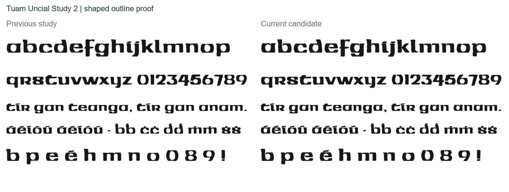
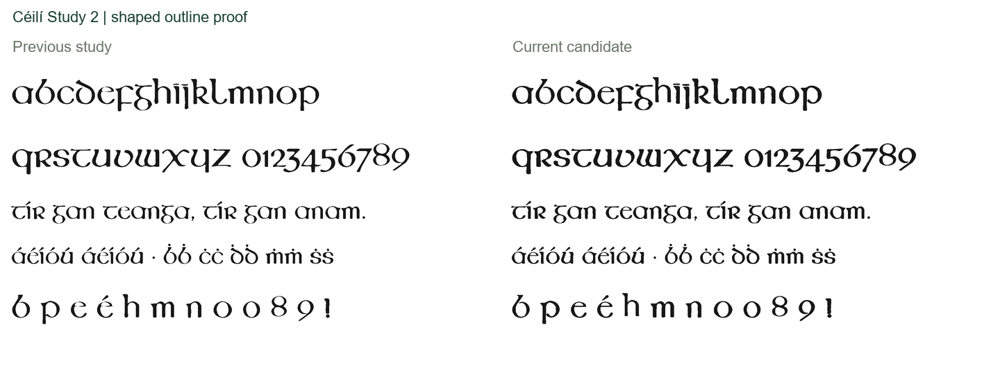
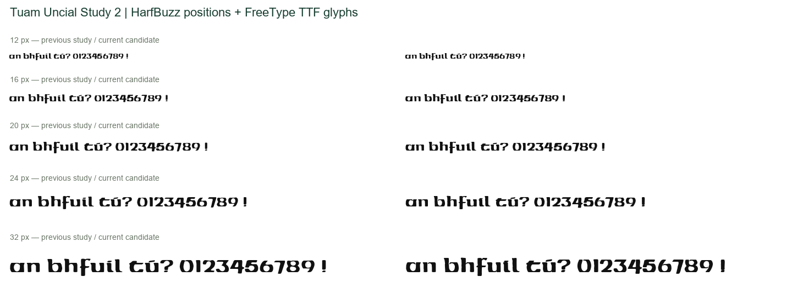
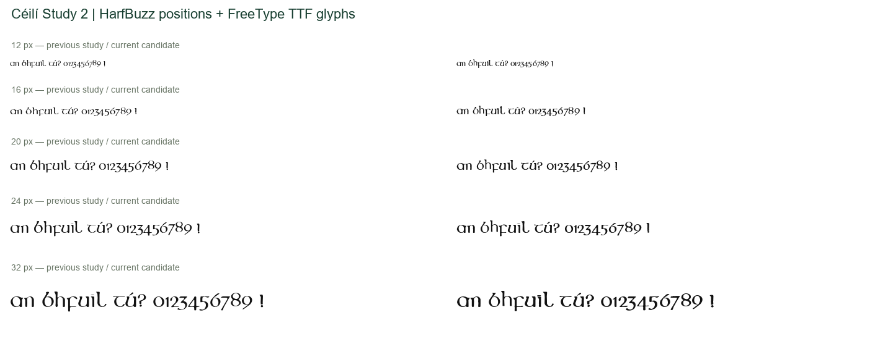

# Tuam and Céilí: original-source round 3

New Regular outline studies for **Tuam Uncial Study 2** and **Céilí Study 2**.
The latest four-family set also uses [Kilfane Study 2 and Carrick Study 1 from
round 2](../round-02/README.md), unchanged. Released families remain unchanged.

| Candidate | New source trace entries | Glyphs / code points | Files |
|---|---:|---:|---|
| Tuam Uncial Study 2 | 46 of 46 | 262 / 398 | [OTF, TTF, WOFF, WOFF2](tuam/fonts/) |
| Céilí Study 2 | 54 of 55 | 317 / 408 | [OTF, TTF, WOFF, WOFF2](ceili/fonts/) |

Glyph counts include `.notdef`. These are research candidates under the repository's
[public-domain dedication](LICENSE.txt), not a claim of original-master authentication.

## Sources and construction decisions

[N46](https://nival.contentdm.oclc.org/digital/collection/p21086coll129/id/46/)
is the 2140 × 3000 historical production flyer, substantially larger than the
release's source image. [N45](https://nival.contentdm.oclc.org/digital/collection/p21086coll129/id/45/)
is the 3000 × 2106 competition brochure. They are different reproductions and may
share artwork or intermediate copies. Native image hashes, exact component labels,
coordinates, source scales, row baselines and blur settings accompany the traces.

**Tuam:** all 46 trace entries use N46. Detached parts and open joins remain open.
In particular, `a`, `o` and `zero` have visible slits in both N46 and N45; repeated
`o` shapes on Bolger volume 2, PDF p.164, figure 206 also show the same opening,
although that photograph has limited resolution. No speculative closure is added.
The five accented source entries are traced, but the text builder reconstructs
accented characters from their base letters and the acute extracted from `uacute`.
Their source comparisons therefore include modern attachment/layout decisions.

**Céilí:** 50 entries use N46; `b`, `e`, `e.alt1` and `h` use the clearer N45
brochure. The old `h` repair borrowed a leg from `n`; the new `h` uses its own
source outline. The previous eye bridge and minimum-stroke repairs for `b/e/e.alt1`
are disabled only for this candidate. The `e` eyes remain closed naturally; `b`
and `p` retain their observed open bowl joins. `DOTS`, the loose punctuation
cluster, remains the previous trace until its components are explicitly mapped.

The inherited builder still regularises text heights, constructs modern language
extensions, assembles punctuation and places marks. Directly traced originals,
retained entries and modern constructions remain distinguished in the provenance.
No modern revival font supplied design geometry.

## A topology defect found and corrected

Unconditional smoothing joined Céilí's exclamation dot to its stem and closed
Tuam's `eight` and `nine` openings. A fresh review confirmed this in both source
fields and actual font binaries. The tracer now tries bounded blur levels from
0.8 down to zero native pixels, accepting only a level that preserves the source's
substantive contour topology. Each entry records the chosen level. Binary tests
check these specific cases in both OTF and TTF.

[The additional topology audit](topology-audit.json) compares 95 directly traced
entries with their actual OTF contours, excluding Tuam's recomposed accents.
93 match at the six-native-pixel contour-area threshold. The two exceptions are
small enclosed flecks in Tuam `d` (7.08 px²) and `dollar` (6.03 px²), removed by
the inherited small-hole/fitting cleanup; their much larger intended counters
remain. These exceptions are recorded rather than silently counted as matches.

## Source comparison results

The new audit uses **pixel-centred 8 × 8 area sampling**, thresholded at 0.5,
with uniform scale and integer translation. Native-size inclusive polygon filling
can add a pixel to edges, materially biasing thin-stroke comparisons. Square-area,
fractional-edge and counter tests cover the replacement sampler. Old saved audit
numbers retain their original method; do not compare their absolute values directly.

| Face / reproduction | Entries | Previous study mean IoU | Candidate mean IoU | Improved |
|---|---:|---:|---:|---:|
| Tuam / N46 | 46 | 0.91390 | 0.94398 | 44 |
| Tuam / N45 | 46 | 0.88382 | 0.88083 | 22 |
| Céilí / N46 | 54 | 0.83682 | 0.92068 | 52 |
| Céilí / N45 | 54 | 0.83286 | 0.85354 | 35 |

Raw per-entry results: [Tuam](tuam/audit-metrics.json), [Céilí](ceili/audit-metrics.json).
All source entries were visually inspected. The larger flyer is the principal
production target, but the brochure disagreement is real: **Tuam's aggregate
brochure fit decreases slightly**. Against N46, Tuam `five` has a small negative
delta and reconstructed `uacute` loses 0.01190; Céilí `b` and `h` also regress.
The clearer directly sourced `h` is retained despite the earlier constructed
repair's higher overlap. Source clarity and construction provenance matter as
well as the scalar score; this judgment remains revisable.

Brochure-only proposals were also built. They improve brochure fit while broadly
reducing flyer fit, so they are not substituted wholesale. Their diagnostic
metrics remain in each face's `brochure-proposal-metrics.json`; they predate the
topology fix and are explicitly exploratory, not accepted candidates. The scans
cannot resolve every discrepancy in proportions and print spread.

## Validation and local review

**103 tests pass** on the latest build: original checks, previous-study checks,
all formats through OpenType Sanitizer, unchanged code-point coverage, actual
HarfBuzz shaping, decomposed accents, alternate sets, provenance, topology and
mapped Latin pairs. The [four-family pair audit](pair-audit.json) reports zero
intersections above four square font units across **302,556 character pairs**.
Tuam and Céilí account for 152,402 pairs, repeated in OTF and TTF tests. Default
kerning is required; these are character-pair counts, not unique glyph-pair counts.

The font-rendered proofs below contain no archive pixels. Local review also
includes all source overlays and 12/16/20/24/32 px proofs. Small-size proofs use
HarfBuzz positions and FreeType glyph rasterization from the actual TTFs. They
are not screenshots from every browser or operating system. Optical spacing,
hinting across rasterizers and broader combining-mark sequences remain work.

## Reproduce

Use Python 3.12 and [requirements-study.txt](../../requirements-study.txt).
Set `PYTHONUTF8=1` on Windows. Retrieve N45/N46 using [downloads.json](../downloads.json)
into ignored `build/research/original-specimens/`, preserving filenames and hashes.
Source media and image overlays remain local under [the rights policy](../RIGHTS.md).

```sh
python scripts/trace_tuam_ceili_study.py --face tuam --sources build/research/original-specimens --output build/round-03/tuam/traces
python scripts/trace_tuam_ceili_study.py --face ceili --sources build/research/original-specimens --output build/round-03/ceili/traces
python scripts/build_original_study.py --face tuam --study 2 --traces build/round-03/tuam/traces --output build/round-03/tuam/fonts
python scripts/build_original_study.py --face ceili --study 2 --traces build/round-03/ceili/traces --output build/round-03/ceili/fonts
python scripts/audit_original_study.py --coverage --sources build/research/original-specimens --traces build/round-03/tuam/traces --baseline research/round-02/tuam/fonts/TuamUncialStudy1-Regular.otf --candidate build/round-03/tuam/fonts/TuamUncialStudy2-Regular.otf --output build/round-03/tuam/coverage-audit
python scripts/audit_original_study.py --coverage --sources build/research/original-specimens --traces build/round-03/ceili/traces --baseline research/round-02/ceili/fonts/CeiliStudy1-Regular.otf --candidate build/round-03/ceili/fonts/CeiliStudy2-Regular.otf --output build/round-03/ceili/coverage-audit
python -m pytest -q tests
```

Tests use the committed research artifacts by default. Set `ROUND03_DIR=build/round-03`
to validate fresh builds. `--prefer N45` generates an exploratory brochure proposal;
it does not automatically accept it. Cross-platform byte-identical research builds
have not been established. The legacy empty-envelope warning remains visible.





