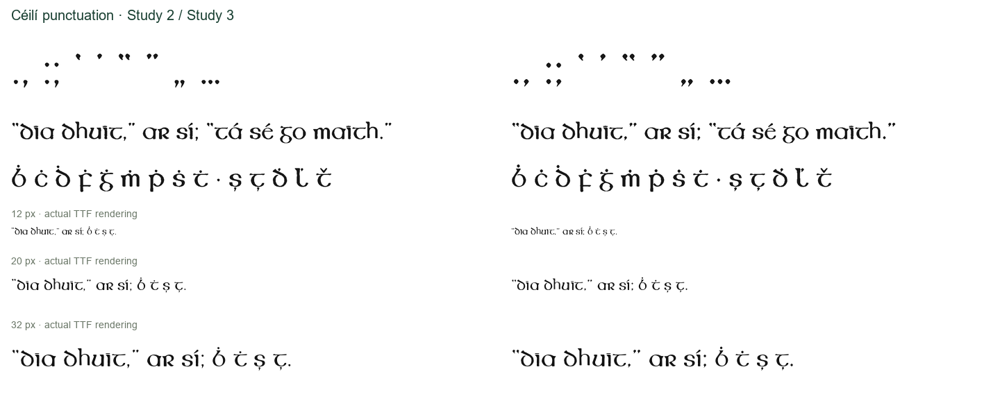

# Céilí: named original punctuation, round 4

**Céilí Study 3** replaces four punctuation inputs with explicitly identified
historical shapes: period, comma, opening quote and closing quote. It retains the
Study 2 letter bodies and all 408 mapped code points, with 317 glyphs including
`.notdef`. [OTF, TTF, WOFF and WOFF2](ceili/fonts/) are separately named research
candidates. Use the unchanged [round-3 Tuam](../round-03/README.md) and
[round-2 Kilfane/Carrick](../round-02/README.md) alongside this candidate.

## Evidence and decisions

The [competition brochure, N45](https://nival.contentdm.oclc.org/digital/collection/p21086coll129/id/45/)
preserves diamond-shaped dots and comma tails more clearly than the earlier small
trace. The former builder constructed a comma tail and selected punctuation from
the legacy `DOTS` cluster by proximity. The new inputs are named and traceable:

| Piece | N45 component | Pixel box |
|---|---:|---|
| period | 17 | [1206, 742, 1218, 756] |
| comma | 18 | [1222, 742, 1234, 761] |
| quoteleft | 6 | [1323, 685, 1337, 704] |
| quoteright | 7 | [1340, 685, 1354, 703] |

Labels use threshold 130 and eight-connected components in row box
`[755, 665, 1430, 770]`. The native image hash, transforms, trace recordings and
smoothing levels are in [punctuation.json](ceili/traces/punctuation.json).
One uniform N45 scale is inherited from round 3. Source images are not enhanced.
The opposed quotes retain their observed direction and comma tails remain present.
The colon and semicolon also provide repeated dot/tail examples. Three upper
pieces remain unassigned; this pass does not infer their identities.

Text placement and repeated dots/quotes remain modern construction. Straight
quotes are still drawn wedges, calibrated to the new period width. The dot above
and diaeresis inherit the new period; comma below and turned comma inherit the new
comma; apostrophe caron inherits the closing quote. These are modern extensions
using original components, not claims that the full extended character set was
supplied historically. Construction descriptions accompany the fonts.

The legacy `DOTS` trace remains in the copied body-trace file for continuity but
is discarded by the new builder input. It supplies no final punctuation geometry
in Study 3. Earlier studies and the released families remain available unchanged.

## Comparison and verification

All four direct pieces improve against both reproductions using the round-3
pixel-centred 8×8 coverage audit at uniform scale and integer translation:

| Reproduction | Study 2 mean IoU | Study 3 mean IoU | Improved |
|---|---:|---:|---:|
| N45 brochure | 0.71148 | 0.84960 | 4/4 |
| N46 flyer | 0.69379 | 0.78638 | 4/4 |

[Raw results](ceili/audit-metrics.json) and
[comparison regions](ceili/traces/punctuation-regions.json) preserve the inputs.
The N46 comparison uses the lower semicolon component for the comma. Its faint
tail is incompletely captured at threshold 130, so that score cannot validate
the complete tail. N45 supplies the candidate. The sources may share artwork;
overlap scores are not authentication or independent validation. At only about
12–19 pixels per component, exact corner shape and print spread remain uncertain.

All **64 materially changed glyphs** were inspected in actual-font comparisons:
[changed-glyph records](ceili/changed-glyphs.json) and
[font-only proof pages](ceili/proofs/). The inventory uses overlap below 0.995,
horizontal translation removed, vertical placement preserved; it excludes smaller
rounding differences. Unaccented letter bodies and their alternates retain their
previous silhouettes. Accented and derived forms intentionally change.

**112 tests pass**, including nine new punctuation checks: four-format sanitization,
coverage, direct-piece shape preservation, provenance, body outlines, decomposed
marks and pair collision protection. The expanded
[Céilí audit](ceili/punctuation-pair-audit.json) checks **89,401 Latin-plus-punctuation
pairs in each of OTF and TTF**, plus 1,444 pairs for each of three stylistic sets,
with zero intersections above four square font units. Default kerning is required.
[The latest four-family audit](pair-audit.json) has 312,996 entries: Céilí includes
punctuation; the other three retain their Latin-only round-3 checks.

All twelve default release styles retain identical punctuation-stage paths and
provenance against commit 3451387 in the same Python 3.12 environment. That check
is recorded in [default-release-regression.json](default-release-regression.json).
A fresh reviewer found no material defects and independently checked the four
Regular defaults and the nine new tests. Small proofs use actual TTF glyph
rasterization at 12, 20 and 32 px, with HarfBuzz positions; application-wide
rasterization and finished optical spacing remain separate work.

## Reproduce

Use Python 3.12 and [requirements-study.txt](../../requirements-study.txt).
Set `PYTHONUTF8=1` on Windows. Retrieve exact N45/N46 originals using
[downloads.json](../downloads.json) into ignored `build/research/original-specimens/`.
Preserve image hashes. Keep external media and source overlays local under
[the rights policy](../RIGHTS.md).

```sh
python scripts/trace_ceili_punctuation.py --sources build/research/original-specimens --output build/round-04/ceili/traces
python scripts/build_original_study.py --face ceili --study 3 --traces build/round-04/ceili/traces --output build/round-04/ceili/fonts
python -m pytest -q tests
```

Tests use committed research artifacts by default; set `ROUND04_DIR=build/round-04`
to check fresh builds. To regenerate the isolated punctuation comparison, execute
the following Python from the repository root:

```python
import json, sys
from pathlib import Path
sys.path.insert(0, 'scripts')
from audit_original_study import run
root = Path('build/round-04/ceili')
metadata = json.loads((root/'traces/punctuation-evidence.json').read_text())
regions = json.loads((root/'traces/punctuation-regions.json').read_text())
run(Path('build/research/original-specimens'), regions, metadata['calibration'],
    'ceili', Path('research/round-03/ceili/fonts/CeiliStudy2-Regular.otf'),
    root/'fonts/CeiliStudy3-Regular.otf', root/'audit', coverage=True)
```

The comparison's per-piece initial baselines keep the glyphs inside the raster
before full translation search; they are not historical placement measurements.
The legacy empty-envelope warning remains visible during builds. Cross-platform
byte-identical research builds have not been established.


