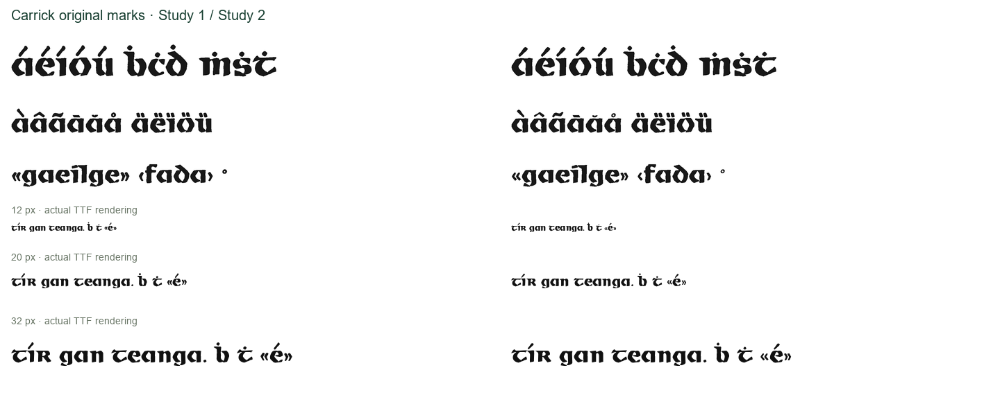

# Carrick: original marks, round 5

**Carrick Study 2** recovers ten isolated mark components from the larger original
alphabet specimen. The candidate has 262 glyphs including `.notdef`, retains all
400 code points, and is supplied in [OTF, TTF, WOFF and WOFF2](carrick/fonts/).
Use it alongside [Céilí Study 3](../round-04/README.md),
[Tuam Uncial Study 2](../round-03/README.md) and
[Kilfane Study 2](../round-02/README.md). These are Regular research candidates.

## What is recovered, retained and constructed

[N513](https://nival.contentdm.oclc.org/digital/collection/p21086coll129/id/513/)
provides two horizontal rules, dot, acute, circumflex, two rings, tilde, and the
two outer opposed chevrons. Each has a recorded component identity, source box,
hash, smoothing level and uniform source transform in
[pieces.json](carrick/traces/pieces.json). The second ring is preserved as a
named source component; the builder uses the right-hand ring for accents and degree.
Letter-body traces remain from Carrick Study 1.

The inner chevrons touch, as does the lower paired shape. Both are preserved as
unassigned evidence. The earlier diaeresis remains explicitly **retained**, since
these reproductions do not establish its isolated shapes or the lower pair's
identity. Paired guillemets repeat the recovered outer chevrons at the inherited
0.88-width pitch; this is a declared modern construction, not a trace of the
hidden inner pieces. The left chevron now uses its own source shape.

Text placement, repeated pieces and derived language marks remain modern work.
Grave and double acute derive from the acute; breve from the ring; caron from the
circumflex. The macron is drawn at the mean weight of the two original rules.
The inherited builder also uses rule weight for modern symbols, and ring weight
for some drawn marks, so **133 glyphs** materially change. This includes Irish
dotted letters, accented letters, guillemets and modern symbols. Every materially
changed glyph was visually inspected in the [font-only proof pages](carrick/proofs/).
The [change inventory](carrick/changed-glyphs.json) uses overlap below 0.995 with
horizontal translation removed and vertical placement retained, excluding smaller
rounding differences. It does not mean all 133 are attested historical glyphs.

## Comparison and verification

Seven final glyphs can be compared directly with the isolated source components:
acute, dot above, ring, circumflex, tilde and the two single guillemets. The rules
are reconstructed into text dashes of modern lengths; the unused ring and ambiguous
pieces are not counted in the final-glyph fit statistic.

| Reproduction | Study 1 mean IoU | Study 2 mean IoU | Improved |
|---|---:|---:|---:|
| N513 alphabet | 0.73806 | 0.93045 | 7/7 |
| N47 flyer | 0.77000 | 0.91132 | 7/7 |

[Raw metrics](carrick/audit-metrics.json) and [regions](carrick/traces/mark-regions.json)
record every comparison. The audit uses pixel-centred 8×8 coverage, fixed uniform
source scale and full integer translation. The scans share reproduction features;
these are source-fit measurements, not independent authentication. Native source
pixels are never enhanced to invent detail.

**123 tests pass**, including eleven new checks for source status, actual component
silhouettes, unchanged letter bodies/diaeresis, ring counters, four-format
sanitization, coverage, provenance, decomposed marks and shaped pairs.
[Carrick's expanded audit](carrick/mark-pair-audit.json) covers **85,849 Latin-plus-
punctuation pairs in each OTF and TTF**, with zero intersections above four square
font units. Default kerning is required. [The current four-family audit](pair-audit.json)
has 324,316 entries: Carrick/Céilí include punctuation, Kilfane/Tuam retain Latin-only
domains. This does not establish finished optical spacing or arbitrary mark stacks.

A fresh reviewer independently checked the nine original new tests, source
assignments and all changed-glyph proofs. Two evidence-description defects were
corrected with failing-then-passing checks: the inherited marks-cluster label and
the macron's two rule-weight inputs. No outline or shaping blocker was found.
The 12/20/32 px proofs use actual TTF rasterization at HarfBuzz positions, not
screenshots from every browser or application. Earlier releases remain unchanged.

## Next original-source work

The [N514 transfer-sheet photograph](https://nival.contentdm.oclc.org/digital/collection/p21086coll129/id/514/)
contains repeated isolated `e` and `f` forms on the large upper sheet. Native crop
boxes are `e: [550,860,1400,1040]`, `f: [310,1030,1000,1220]`. These are useful leads
for replacing the fused alphabet traces after local perspective, print detail and
repeated instances are compared. No `e/f` geometry is changed in this pass.
The photographed portion does not expose `x/y`. The inspected N517 Kilfane photo
does not expose the required `T/U` or lowercase `k/l`. The file identities and
hashes are already in [downloads.json](../downloads.json).

## Reproduce

Use Python 3.12 and [requirements-study.txt](../../requirements-study.txt), with
`PYTHONUTF8=1` on Windows. Retrieve exact N513/N47 originals using
[downloads.json](../downloads.json) into ignored `build/research/original-specimens/`.
Keep archive images and comparisons local under [RIGHTS.md](../RIGHTS.md).

```sh
python scripts/trace_carrick_marks.py --sources build/research/original-specimens --output build/round-05/carrick/traces
python scripts/build_original_study.py --face carrick --study 2 --traces build/round-05/carrick/traces --output build/round-05/carrick/fonts
python -m pytest -q tests
```

Tests use committed artifacts by default. Set `ROUND05_DIR=build/round-05` for a
fresh build. Regenerate the comparisons from the repository root with:

```python
import json, sys
from pathlib import Path
sys.path.insert(0, 'scripts')
from audit_original_study import run
root = Path('build/round-05/carrick')
evidence = json.loads((root/'traces/mark-evidence.json').read_text())
regions = json.loads((root/'traces/mark-regions.json').read_text())
run(Path('build/research/original-specimens'), regions, evidence['calibration'],
    'carrick', Path('research/round-02/carrick/fonts/CarrickStudy1-Regular.otf'),
    root/'fonts/CarrickStudy2-Regular.otf', root/'audit', coverage=True)
```

The per-piece initial baselines keep glyphs inside the raster before translation
search; they are not historical placement measurements. The legacy empty-envelope
warning remains visible. Cross-platform byte-identical research builds have not
been established.


